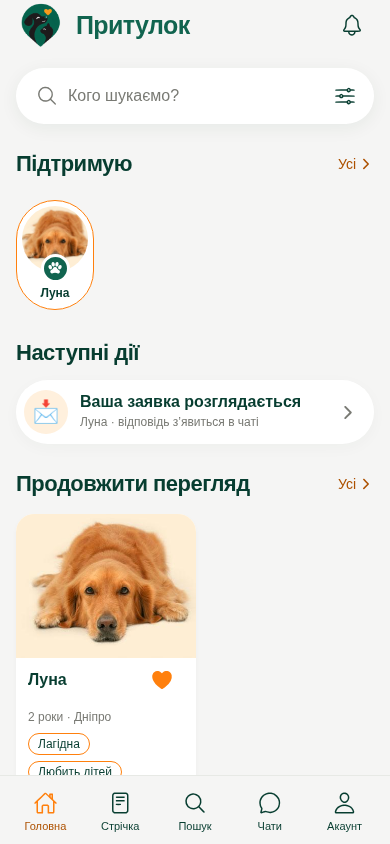
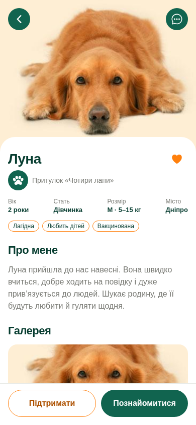

# Притулок 🐾

Інтерактивний українськомовний UI-прототип для пошуку, підтримки та знайомства з тваринами. Expo SDK 58, React Native, TypeScript. Дизайн — за наданими референсами Figma: глибокий зелений, помаранчевий, світлі поверхні, великі фотографії.

```bash
npm ci
npm run check
npm test
npm run export:android
npm start
```

[Запуск, сценарії та перевірки](START-HERE.uk.md).

Авторизація, повідомлення, заявки й платежі демонстраційні. Реального сервера та списання коштів немає.

## Подивитися прототип

 

[Усі скріншоти](docs/preview) · [Інструкція запуску](START-HERE.uk.md)

Щоб відкрити **цю версію** в Expo Go, у PowerShell на комп’ютері з Node.js 24 LTS та Git:

```powershell
git clone --branch codex/prytulok-ui-prototype https://github.com/sergienkomm-crypto/-prytulok-app.git prytulok-preview
cd prytulok-preview
npm ci
npm start -- --lan
```

Телефон і комп’ютер під’єднайте до однієї Wi-Fi мережі. На Android відкрийте Expo Go, сумісний з SDK 58, і відскануйте QR-код із термінала. Для повторного запуску з папки проєкту достатньо `npm start -- --lan`.
